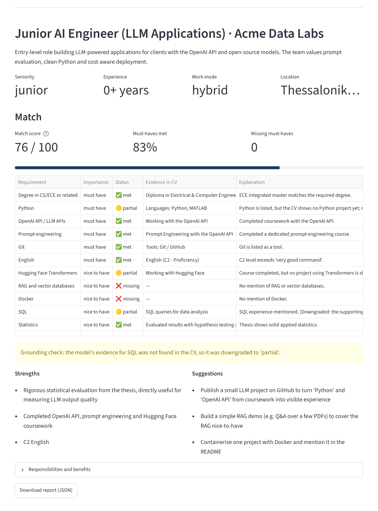

# 🧭 Job Analyzer

An LLM-powered tool that turns a job posting into structured requirements and compares them with your CV.
Works with **OpenAI** or **Anthropic Claude**.

Paste a job posting (English or Greek), optionally upload your CV, and get:

- the **requirements** of the role, split into *must have* and *nice to have*, each with the exact phrase from the posting;
- a **match score** and, for every requirement, whether your CV meets it, with a quote from the CV as evidence;
- **strengths** to highlight and honest **suggestions** for closing the gaps.



## How it works

```
job posting ──► LLM call 1 ──► JobPosting (structured)
                               │
CV ────────────────────► LLM call 2 ──► CVMatch (structured)
                                             │
                               Python scoring + grounding check ──► MatchReport
```

1. **Structured extraction.** The Pydantic models in [`schemas.py`](job_analyzer/schemas.py)
   are sent to the model as the response schema, so it must answer with valid,
   typed JSON. Two providers implement the same small interface in
   [`providers.py`](job_analyzer/providers.py): OpenAI (Responses API,
   `responses.parse`) and Anthropic Claude (Messages API, `messages.parse`).
   The rest of the pipeline does not know which one ran.
2. **Deterministic scoring.** The model decides *whether* each requirement is met;
   Python turns that into a score ([`scoring.py`](job_analyzer/scoring.py)).
   Must-haves count double; met = 1, partial = 0.5, missing = 0. The same input
   always gives the same score, and the formula is easy to explain.
3. **Grounding check.** Every quote the model returns is checked against the
   original text (ignoring case, accents and punctuation). If the model marks a
   skill as *met* but its evidence does not appear in the CV, the skill is
   downgraded to *partial* and flagged. Requirements the model skipped are
   counted as *missing* instead of being silently ignored.
4. **Prompt-injection hygiene.** The job posting and CV are wrapped in tags and the
   instructions tell the model to treat them as data, not instructions.
5. **Monitoring.** Token usage and latency of each call are shown in the app.

## Tech stack

Python · OpenAI API · Anthropic Claude API · Structured Outputs · Pydantic · Streamlit · pandas · pypdf · python-docx · pytest · GitHub Actions

## Run it locally

Requires Python 3.10+.

```bash
git clone https://github.com/AlexStou/job-analyzer.git
cd job-analyzer
python -m venv .venv
source .venv/bin/activate        # Windows: .venv\Scripts\activate
pip install -r requirements.txt

cp .env.example .env             # Windows: copy .env.example .env
# then open .env and paste your OpenAI or Anthropic API key

streamlit run app.py
```

No API key? Leave it empty: the app starts in **demo mode** and shows a
precomputed analysis of the example posting and CV in [`examples/`](examples).

Pick the provider and model in the sidebar. Defaults: `gpt-5.4-mini` (OpenAI)
and `claude-haiku-5-5` (Anthropic); override them with `OPENAI_MODEL` or
`ANTHROPIC_MODEL` in `.env`.

## Tests

The tests use fake clients and mocked HTTP, so they run without an API key or
network access. They also check that the real OpenAI and Anthropic SDKs accept
the schemas and parse a response.

```bash
pip install -r requirements-dev.txt
pytest
```

They run automatically on every push with GitHub Actions.

## Deploy (free)

1. Push the repo to GitHub.
2. On [Streamlit Community Cloud](https://streamlit.io/cloud), create a new app from the repo with `app.py` as the entry point.
3. Under *Settings → Secrets*, add `OPENAI_API_KEY = "sk-..."` and/or `ANTHROPIC_API_KEY = "sk-ant-..."`.
   Leave it out if you only want to show demo mode.

## Project structure

```
app.py                     Streamlit interface
job_analyzer/
  schemas.py               Pydantic models used as structured-output schemas
  prompts.py               System instructions
  providers.py             OpenAI and Anthropic clients behind one interface
  analyzer.py              Pipeline: extract → match → score
  scoring.py               Score calculation and grounding check
  file_loader.py           Read CVs from PDF, DOCX or TXT
examples/                  Fictional job posting, fictional CV, demo output
tests/                     pytest suite
```

## Limitations and ideas

- The match quality depends on the model; the grounding check catches invented
  evidence but not every misjudgement.
- Scanned PDFs (images) have no text layer and cannot be read.
- Ideas: batch-analyze several ads to find the most requested skills, compare
  results across models, or add a Hugging Face model for skill extraction.

## License

MIT
